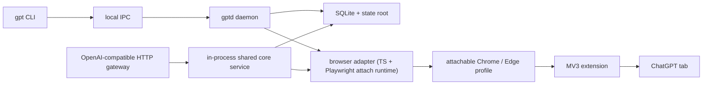

# Tablinq

**Use ChatGPT as a real local provider, through your real browser session.**

Tablinq turns a signed-in ChatGPT tab into:

- a local CLI for ask, research, jobs, sessions, and artifacts
- a local daemon with durable state and recovery
- an OpenAI-compatible `/v1/*` gateway for tools and agents

It also plugs directly into [OpenClaude](docs/openclaude.md) and [Paperclip](docs/paperclip.md) through that local gateway.

Tablinq is built for the case where the browser is the provider. It does not export cookies, replay hidden bearer tokens, or pretend the website is a raw API.

## Start here

- Install or operate Tablinq: [docs/install.md](docs/install.md)
- Work from a repo checkout: [docs/development.md](docs/development.md)
- Use the OpenAI-compatible gateway: [docs/provider-mode.md](docs/provider-mode.md)
- Debug attach, extension, auth, or recovery issues: [docs/troubleshooting.md](docs/troubleshooting.md)
- Validate against the real ChatGPT site: [docs/live-smoke-checklist.md](docs/live-smoke-checklist.md)

## Why Tablinq exists

If you want local tools to work through ChatGPT without handing out browser secrets, you need a product that respects the browser as the source of truth.

That is what Tablinq does:

- it attaches to a real Chrome or Edge session through a local debug endpoint
- it uses a browser extension as the semantic page bridge
- it keeps local jobs, conversations, artifacts, logs, and failure bundles on your machine
- it exposes an OpenAI-compatible local gateway without hiding the browser-backed reality

## Why Playwright is not the primary login workflow

Tablinq still uses Playwright internally, but **not** as the default browser owner.

Using a Playwright-owned browser profile as the normal sign-in and startup path is the wrong operational model for `chatgpt.com`. Cloudflare and anti-bot protections make automation-owned browser startup and login materially less reliable than a normal user-owned browser session.

The current design is the correct default for this product:

- you run an attachable browser profile you can inspect yourself
- you install the Tablinq extension in that same attach target profile
- you sign in manually
- Tablinq attaches to that existing browser session through a local debug endpoint

On current Chrome, `gpt browser start-debug` uses a dedicated persistent real Chrome profile under the Tablinq state root because Chrome requires `--user-data-dir` for remote debugging outside the default profile. This is still attach-first, not managed fallback. Sign in once in that dedicated Chrome attach profile before running `gpt browser attach`.

Playwright remains in the system as an attach-and-assist runtime for:

- browser attach and tab discovery
- focus or navigation when needed
- screenshots
- uploads and downloads
- reload and disconnect recovery

It is no longer the default owner of your ChatGPT login session.

## What you get

- **Real browser execution.** Tablinq runs against the same ChatGPT session you can inspect yourself.
- **Local-first control plane.** The CLI, daemon, gateway, SQLite state, logs, uploads, downloads, and failure bundles stay local.
- **OpenAI-compatible gateway.** Tools can call `http://127.0.0.1:3847/v1` instead of screen-scraping on their own.
- **Conservative recovery.** Interrupted browser-backed work is tracked explicitly and reconciled only when it is safe.
- **Fallback when needed.** `managed_only` and `managed_fallback` still exist for debugging, CI, harness isolation, and machines that cannot expose a usable debug endpoint.

## Recommended workflow

This is the normal operating path:

1. Install Tablinq.
2. Start the local control plane:
   - `gpt daemon start`
   - `gpt gateway start`
3. Start an attachable browser session:
   - `gpt browser start-debug`
4. Load the Tablinq extension into the attach target profile.
   - Edge attach-first normally uses the Edge profile you started.
   - Current Chrome attach-first uses the dedicated `chrome-attach-profile` under the Tablinq state root.
5. Sign in manually at `https://chatgpt.com/` in that same browser profile.
6. Attach Tablinq:
   - `gpt browser attach`
7. Confirm health:
   - `gpt status`
   - `gpt doctor`
   - `gpt browser connection-info`
   - `gpt capabilities`
8. Run work:
   - `gpt ask "Turn this changelog into three release-note bullets."`
   - `gpt research "Find launch risks for a Windows tray app."`

## Quick Start

Windows packaged install:

```powershell
scripts/install.ps1

gpt daemon start
gpt gateway start
gpt browser start-debug
# load the extension into the attach target profile, then sign in manually
gpt browser attach
gpt doctor
gpt ask "Turn this changelog into three release-note bullets."
```

Repo-checkout development:

```bash
pnpm install
cargo test -p gpt
pnpm run test:ts:fast

cargo run -p gpt -- daemon start
cargo run -p gpt -- gateway start
cargo run -p gpt -- browser start-debug
cargo run -p gpt -- browser attach
cargo run -p gpt -- ask "Draft a two-line release note for faster startup."
```

If your repo checkout grows large during development, run `cargo clean` to remove the local Rust `target/` build directory. That deletes compiled binaries, PDBs, incremental caches, and packaging-related build outputs, and the next Rust build will rebuild them from scratch.

## Command surface

Common commands:

- `gpt version`
- `gpt status`
- `gpt doctor`
- `gpt capabilities`
- `gpt config show`
- `gpt daemon start`
- `gpt daemon status`
- `gpt daemon stop`
- `gpt gateway start`
- `gpt gateway status`
- `gpt gateway stop`
- `gpt ask "Name three edge cases for resumable downloads."`
- `gpt ask --mode search "Which Rust release first stabilized let-chains?"`
- `gpt ask --model thinking --effort extended "Choose SQLite or JSONL for a local job ledger."`
- `gpt ask --mode search --model thinking --effort standard "Find current Windows code-signing costs."`
- `gpt ask --mode search --conversation conv-123 "Refresh the shipping checklist against current notarization rules."`
- `gpt ask --file notes.txt "Extract the open decisions from this meeting note."`
- `gpt ask --file crash.log --file repro.md "Find the first failing step and likely owner."`
- `gpt ask --conversation conv-123 "Turn the last answer into a migration checklist."`
- `gpt ask --new-conversation "Sketch a smoke test for a stuck progress bar."`
- `gpt research "Find launch risks for a Windows tray app."`
- `gpt research --file notes.txt --output-dir reports "Write a two-page vendor-risk brief."`
- `gpt research --file roadmap.md --file support.csv --output-dir reports "Prioritize churn risks for next quarter."`
- `gpt jobs list`
- `gpt jobs show job-123`
- `gpt jobs cancel job-123`
- `gpt sessions list`
- `gpt conversations list`
- `gpt conversations list --json`
- `gpt conversations switch conv-123`
- `gpt conversations new`
- `gpt conversations new --json`
- `gpt artifacts list`
- `gpt artifacts pull last --to .`
- `gpt clear --all --force`
- `gpt browser start-debug`
- `gpt browser attach`
- `gpt browser connection-info`
- `gpt browser open`
- `gpt browser detach`
- `gpt browser profile-info`

`attach_first` is the default mode. `gpt browser detach` disconnects Tablinq from the user-owned browser and does not close Chrome. Tablinq does not provide CLI commands to log out, switch ChatGPT accounts, or reset browser profiles; manage those actions directly in the attached browser profile.

## Provider mode

Tablinq can expose the same browser-backed session through a local OpenAI-compatible gateway.

- base URL: `http://127.0.0.1:3847/v1`
- auth: local gateway API key from `config.toml`
- recommended concurrency: `1`
- recommended branch concurrency: `1`
- subagents disabled by default

Recommended model families:

- `tablinq-instant`
- `tablinq-thinking-standard`
- `tablinq-thinking-extended`
- `tablinq-search`
- `tablinq-research`

See:

- [docs/provider-mode.md](docs/provider-mode.md)
- [docs/openclaude.md](docs/openclaude.md)
- [docs/paperclip.md](docs/paperclip.md)

## Windows Troubleshooting

See [docs/troubleshooting.md](docs/troubleshooting.md#antivirus-blocking-local-tools-or-browser-startup) for symptoms and exception candidates.

## Architecture



See [docs/architecture.md](docs/architecture.md) for the full model.

## Repository map

- `crates/gpt`: CLI
- `crates/gptd`: daemon, config, state, browser orchestration, SQLite
- `crates/shared-protocol`: stable protocol types and state-path helpers
- `crates/tablinq-gateway`: local OpenAI-compatible HTTP gateway
- `crates/tablinq-host`: native messaging host for the extension
- `packages/browser-adapter`: Playwright-backed attach runtime
- `packages/extension`: MV3 extension bridge and capability probes
- `packages/fake-chatgpt`: fake harness for browser tests
- `selector-packs/v1`: selector data outside compiled code
- `schemas/v1`: versioned protocol contracts
- `docs`: install, development, architecture, provider, and troubleshooting guides

## Validation

Smallest useful validation depends on the files touched:

- Rust CLI: `cargo test -p gpt`
- Daemon: `cargo test -p gptd`
- Gateway: `cargo test -p tablinq-gateway`
- TypeScript core/protocol/probe checks: `pnpm run test:ts:fast`
- Browser-adapter shards:
  - `pnpm run test:browser-adapter:foundation`
  - `pnpm run test:browser-adapter:ask`
  - `pnpm run test:browser-adapter:research`
  - `pnpm run test:browser-adapter:recovery`

Broader validation:

- `cargo test`
- `pnpm lint`
- `pnpm build`
- `pnpm test`
- `pnpm run ci:local`
- `pnpm run ci:local:all`

If you touch packaging or installed behavior on Windows, also run `pnpm run ci:local:package-smoke`.

## Documentation

- [Install](docs/install.md)
- [Troubleshooting](docs/troubleshooting.md)
- [Development](docs/development.md)
- [Architecture](docs/architecture.md)
- [Provider mode](docs/provider-mode.md)
- [OpenClaude](docs/openclaude.md)
- [Paperclip](docs/paperclip.md)
- [Live smoke checklist](docs/live-smoke-checklist.md)
