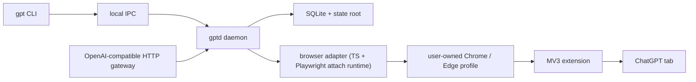

# Tablinq

**Use ChatGPT as a real local provider, through your real browser session.**

Tablinq turns a signed-in ChatGPT tab into:

- a local CLI for ask, research, jobs, sessions, and artifacts
- a local daemon with durable state and recovery
- an OpenAI-compatible `/v1/*` gateway for tools and agents

It also plugs directly into [OpenClaude](docs/openclaude.md) and [Paperclip](docs/paperclip.md) through that local gateway.

Tablinq is built for the case where the browser is the provider. It does not export cookies, replay hidden bearer tokens, or pretend the website is a raw API.

## Why Tablinq exists

If you want local tools to work through ChatGPT without handing out browser secrets, you need a product that respects the browser as the source of truth.

That is what Tablinq does:

- it attaches to a real Chrome or Edge session through a local debug endpoint
- it uses a browser extension as the semantic page bridge
- it keeps local jobs, conversations, artifacts, logs, and failure bundles on your machine
- it exposes an OpenAI-compatible local gateway without hiding the browser-backed reality

## Why Playwright is not the primary login workflow

Tablinq still uses Playwright internally, but **not** as the default browser owner.

Using a Playwright-owned browser profile as the normal sign-in and startup path is the wrong operational model for `chatgpt.com`. Cloudflare and anti-bot protections make automation-owned browser startup and login materially less reliable than a normal user-owned browser session.

The current design is the correct default for this product:

- you run your normal browser
- you install the Tablinq extension in that real profile
- you sign in manually
- Tablinq attaches to that existing browser session through a local debug endpoint

On current Chrome, `gpt browser start-debug` uses a dedicated persistent real Chrome profile under the Tablinq state root because Chrome requires `--user-data-dir` for remote debugging outside the default profile. This is still attach-first, not managed fallback. Sign in once in that dedicated Chrome attach profile before running `gpt browser attach`.

Playwright remains in the system as an attach-and-assist runtime for:

- browser attach and tab discovery
- focus or navigation when needed
- screenshots
- uploads and downloads
- reload and disconnect recovery

It is no longer the default owner of your ChatGPT login session.

## What you get

- **Real browser execution.** Tablinq runs against the same ChatGPT session you can inspect yourself.
- **Local-first control plane.** The CLI, daemon, gateway, SQLite state, logs, uploads, downloads, and failure bundles stay local.
- **OpenAI-compatible gateway.** Tools can call `http://127.0.0.1:3847/v1` instead of screen-scraping on their own.
- **Conservative recovery.** Interrupted browser-backed work is tracked explicitly and reconciled only when it is safe.
- **Fallback when needed.** `managed_only` and `managed_fallback` still exist for debugging, CI, harness isolation, and machines that cannot expose a usable debug endpoint.

## Recommended workflow

This is the normal operating path:

1. Install Tablinq and load the extension into your normal Chrome or Edge profile.
2. Start the local control plane:
   - `gpt daemon start`
   - `gpt gateway start`
3. Start an attachable browser session:
   - `gpt browser start-debug`
4. Sign in manually at `https://chatgpt.com/` in that browser profile.
   Current Chrome uses a dedicated persistent attach profile under the Tablinq state root; Edge keeps the existing flow.
5. Attach Tablinq:
   - `gpt browser attach`
6. Confirm health:
   - `gpt status`
   - `gpt doctor`
   - `gpt browser connection-info`
   - `gpt capabilities`
7. Run work:
   - `gpt ask "Summarize the value of Tablinq in one paragraph."`
   - `gpt research "Investigate launch blockers for a desktop AI tool."`

## Quick start

```bash
pnpm install
cargo test
pnpm test

gpt daemon start
gpt gateway start
gpt browser start-debug
# sign in manually in the opened browser if needed
gpt browser attach
gpt ask "Summarize the value of Tablinq in one paragraph."
gpt status
```

For install instructions, see [docs/install.md](docs/install.md).

## Command surface

Common commands:

- `gpt version`
- `gpt status`
- `gpt doctor`
- `gpt capabilities`
- `gpt config show`
- `gpt daemon start`
- `gpt daemon status`
- `gpt daemon stop`
- `gpt gateway start`
- `gpt gateway status`
- `gpt gateway stop`
- `gpt ask "hello"`
- `gpt ask --model instant --mode search "latest release notes"`
- `gpt ask --model thinking --effort extended "compare these options"`
- `gpt ask --file notes.txt "summarize the attachment"`
- `gpt research "investigate launch blockers"`
- `gpt jobs list`
- `gpt jobs show job-123`
- `gpt jobs cancel job-123`
- `gpt sessions list`
- `gpt artifacts list`
- `gpt artifacts pull last`
- `gpt browser start-debug`
- `gpt browser attach`
- `gpt browser connection-info`
- `gpt browser open`
- `gpt browser close`
- `gpt browser logout`
- `gpt browser switch-account`
- `gpt browser reset-profile`
- `gpt browser profile-info`

`attach_first` is the default mode. `gpt browser reset-profile` is for `managed_only` and `managed_fallback` only.

## Provider mode

Tablinq can expose the same browser-backed session through a local OpenAI-compatible gateway.

- base URL: `http://127.0.0.1:3847/v1`
- auth: local gateway API key from `config.toml`
- recommended concurrency: `1`
- recommended branch concurrency: `1`
- subagents disabled by default

Recommended model families:

- `tablinq-instant`
- `tablinq-thinking-standard`
- `tablinq-thinking-extended`
- `tablinq-search`
- `tablinq-research`

See:

- [docs/provider-mode.md](docs/provider-mode.md)
- [docs/openclaude.md](docs/openclaude.md)
- [docs/paperclip.md](docs/paperclip.md)

## Antivirus warning on Windows

Some Windows antivirus products can block packaging, browser startup, local scripts, `node.exe`, `pwsh.exe`, `chrome.exe`, `cmd.exe`, or toolchain binaries such as `esbuild.exe`. If local install, packaging, or test runs fail with `Access is denied` or a blocked-process notification, add the relevant paths to your antivirus exceptions and restore any already-blocked executables from quarantine or notifications.

Paths that may require exceptions in a typical Windows dev or install environment:

- `<repo-root>`
- `<repo-root>\scripts`
- `<repo-root>\scripts\*.ps1`
- `%LOCALAPPDATA%\Tablinq`
- `%LOCALAPPDATA%\Tablinq\daemon.lock`
- `%LOCALAPPDATA%\Tablinq\install\bin`
- `%LOCALAPPDATA%\Tablinq\install\bin\gpt.exe`
- `%LOCALAPPDATA%\Tablinq\install\bin\gpt.cmd`
- `%LOCALAPPDATA%\Tablinq\install\bin\tablinq-cli.exe`
- `%LOCALAPPDATA%\Tablinq\install\bin\gptd.exe`
- `%LOCALAPPDATA%\Tablinq\install\bin\tablinq-gateway.exe`
- `%LOCALAPPDATA%\Tablinq\install\bin\tablinq-host.exe`
- `%APPDATA%\Microsoft\Windows\Start Menu\Programs\Startup`
- `%APPDATA%\Microsoft\Windows\Start Menu\Programs\Startup\Tablinq Daemon.vbs`
- `%APPDATA%\Microsoft\Windows\Start Menu\Programs\Startup\Tablinq Gateway.vbs`
- `%NVM_SYMLINK%`
- `%SystemRoot%\System32\WindowsPowerShell\v1.0\powershell.exe`
- `%SystemRoot%\System32\reg.exe`
- `%NVM_SYMLINK%\node.exe`
- `%LOCALAPPDATA%\nvm`
- `%ProgramFiles%\PowerShell\7\pwsh.exe`
- `%ProgramFiles%\Google\Chrome\Application\chrome.exe`
- `%LOCALAPPDATA%\nvm\v20.19.3\node.exe`
- `%SystemRoot%\System32\cmd.exe`
- `<repo-root>\node_modules\.pnpm\@esbuild+win32-x64@0.27.7\node_modules\@esbuild\win32-x64\esbuild.exe`
- `<repo-root>\node_modules`

Add equivalent paths for your own machine if the install location, browser, or Node version differs.

## Architecture



See [docs/architecture.md](docs/architecture.md) for the full model.

## Repository map

- `crates/gpt`: CLI
- `crates/gptd`: daemon, config, state, browser orchestration, SQLite
- `crates/shared-protocol`: stable protocol types and state-path helpers
- `crates/tablinq-gateway`: local OpenAI-compatible HTTP gateway
- `crates/tablinq-host`: native messaging host for the extension
- `packages/browser-adapter`: Playwright-backed attach runtime
- `packages/extension`: MV3 extension bridge and capability probes
- `packages/fake-chatgpt`: fake harness for browser tests
- `selector-packs/v1`: selector data outside compiled code
- `schemas/v1`: versioned protocol contracts
- `docs`: install, development, architecture, provider, and troubleshooting guides

## Validation

Local validation:

- `cargo test`
- `pnpm lint`
- `pnpm build`
- `pnpm test`

If you touch packaging or installed behavior on Windows, also run the package smoke path.

## Documentation

- [Install](docs/install.md)
- [Troubleshooting](docs/troubleshooting.md)
- [Development](docs/development.md)
- [Architecture](docs/architecture.md)
- [Provider mode](docs/provider-mode.md)
- [OpenClaude](docs/openclaude.md)
- [Paperclip](docs/paperclip.md)
- [Live smoke checklist](docs/live-smoke-checklist.md)
