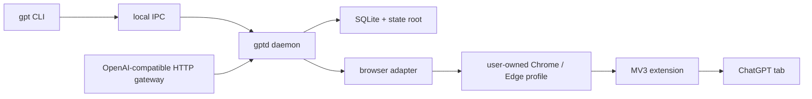

# Architecture

Tablinq is browser-driven by design. The browser is the execution engine, not a side effect.

## Core idea

The modern Tablinq stack is attach-first:

- the user owns the browser session
- the user signs in manually
- the extension is the semantic bridge
- Playwright is used as an attach-and-assist runtime
- Rust owns the durable control plane

The old managed Playwright-owned login path is no longer the primary model. That approach failed as a default because Cloudflare and anti-bot protection at `chatgpt.com` made automation-owned startup and login the wrong boundary for a production workflow.

## Ownership boundaries

- Rust owns durable types, validation, the CLI, daemon, gateway, config, logging, SQLite persistence, and package/install flow.
- TypeScript owns the browser adapter, extension bridge, capability probes, and fake browser harness.
- Selector strategies live in `selector-packs/v1/*.json` instead of being compiled into the adapter.
- Stable protocol and schema contracts live under `crates/shared-protocol` and `schemas/v1`.

## Runtime topology

1. `gpt` parses local commands and sends daemon requests over local IPC.
2. `gptd` owns durable execution, persistence, request lifecycle state, and one supervised browser adapter process.
3. `tablinq-gateway` exposes an OpenAI-compatible HTTP surface backed by the same core service.
4. The browser adapter attaches to a user-owned Chrome or Edge browser session through a local debug endpoint, or launches managed fallback explicitly when configured.
5. The extension probes the page and publishes capability and alias data back to the control loop.

## High-level flow

## Browser runtime model

- The CLI never talks to the browser directly.
- The daemon supervises the browser adapter process.
- The browser adapter is launched from packaged `service.js` output when present and falls back to repo `service.ts` in a developer checkout.
- In `attach_first`, the adapter connects to a running local debug endpoint, discovers the best ChatGPT tab, or opens a target tab if needed.
- In `managed_only` or `managed_fallback`, the adapter can still launch an owned managed context for debugging, CI, or machines that cannot expose an attachable browser.
- In attach mode, Tablinq does not own the whole browser and must detach cleanly instead of killing the user's browser process.

## Extension-first control

The extension is the semantic source of truth for:

- capability matrix
- alias discovery
- UI signature
- preferred selector strategy matches

The browser adapter uses CDP and Playwright transport for:

- attach and detach
- target-tab discovery
- focus and navigation assistance
- screenshots
- upload and download coordination
- reload and disconnect detection

## State layout

The resolved state root contains:

- `config/config.toml`
- `logs/gptd.log`
- `logs/gateway.log`
- `db/tablinq.sqlite3`
- `browser-profile/`
- `downloads/`
- `crash-bundles/`
- `gateway-uploads/`
- `daemon.lock`

`browser-profile/` remains in the layout because managed fallback still exists and compatibility with earlier state roots matters.

## Request lifecycle

Ask and research requests move through explicit states:

- `queued`
- `starting`
- `running`
- `interrupted`
- `recovered`
- terminal states such as `completed`, `failed`, or `cancelled`

Those states are persisted and surfaced through the CLI and gateway so clients can distinguish:

- still-running work
- interrupted work that may still be active upstream
- recovered work reconciled after interruption
- unrecoverable failures

## Ask and research flow

- `gpt ask` becomes `DaemonRequest::Ask`, which streams `EventPayload` frames followed by a final `DaemonResponse`.
- `gpt research` becomes `DaemonRequest::Research`, which runs through a durable job path with progress updates and artifact persistence.
- The daemon persists jobs, sessions, conversations, request summaries, artifacts, and failure bundles in SQLite and the state root.
- The gateway reuses the same core service instead of duplicating execution logic.

## Capability and selector model

- The extension publishes a capability matrix plus runtime alias maps for visible labels.
- The control plane uses those alias maps instead of hardcoding current UI text for model, mode, and effort selection.
- Strategy success and failure telemetry are persisted so the control plane can reuse last-known-good selectors per workspace.

## Interruption and recovery model

Browser-backed execution can fail in ways a direct API call does not:

- browser disconnect
- tab reload or navigation
- local client disconnect while upstream work may still continue
- streaming stalls

Recovery stays conservative:

- requests are detected as interrupted with bounded timeouts
- the adapter reattaches or reconnects to the live browser state when possible
- the live conversation is inspected before any continuation
- a request is marked `recovered` only when the observed assistant result matches safely
- prompts are not blindly resubmitted by default

## Failure handling

Typed failures are surfaced for:

- authentication problems
- capability gaps
- browser attach failures
- managed-fallback launch issues
- upload and download failures
- action timeouts
- provider generation failures that should not use the page Retry button
- research-specific failures
- reconciliation failures after interruption

Failure bundles are written under `crash-bundles/` and recorded in SQLite with screenshot, DOM snapshot, ARIA snapshot, active URL, selector attempts, and linked logs.

## Provider-generation recovery

For the provider page error `Something went wrong while generating the response...`, Tablinq treats the failure as `provider_generation_failed_nonretryable`.

The recovery policy is:

- do not auto-click the provider Retry button
- capture a failure bundle and persist recovery metadata
- reload the target tab
- start a fresh conversation
- replay once through a deterministic recovery wrapper

The replayed request is built in core from durable state, not from the provider's old live thread state.

Current preserved context for this recovery path is intentionally compact:

- the original user request
- request options such as mode, model, and effort
- request-scoped file references tracked by Tablinq
- the prior conversation id
- a durable conversation recovery manifest stored in SQLite and refreshed after each completed turn

That manifest currently preserves:

- archived compact summaries of older turns
- recent turn summaries
- tracked input attachment metadata
- tracked generated artifact metadata

During provider-generation recovery, core uses that manifest to build:

- a concise inline replay wrapper
- an optional recovery-manifest attachment uploaded into the fresh conversation
- a bounded replay file set that can include the latest request files plus recent durable context files

This is stronger than the earlier single-turn summary path, but it is still not a full provider-thread reconstruction.

## HTTP gateway

`tablinq-gateway` exposes OpenAI-compatible endpoints for:

- chat completions
- files
- artifacts
- request status and cancellation
- sessions and provider metadata

It also exposes a local-only read-only conversation inspection and recovery surface over the same persisted daemon state:

- conversation detail and metadata
- normalized conversation history with explicit provenance
- replay-safe conversation snapshots built from durable recovery state

The gateway keeps browser usage stable with queueing and concurrency controls rather than pretending the system is horizontally scalable.
