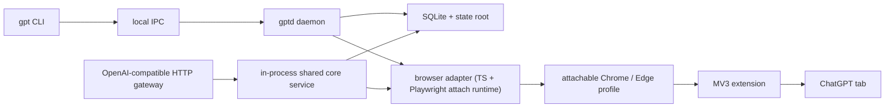

# Project reference

Use this page for detailed operational and technical guidance. Start with the [main README](../README.md) for a concise introduction.

## Product boundaries

Tablinq treats the browser as the provider. It does not export cookies, replay hidden bearer tokens, or pretend that the ChatGPT website is a raw API.

The normal model is attach-first:

- you own the browser process and sign in manually;
- Tablinq attaches through a local debug endpoint;
- the browser extension acts as the semantic page bridge;
- Playwright assists with attachment, navigation, screenshots, uploads, downloads, and recovery;
- the local CLI, daemon, gateway, SQLite state, logs, uploads, downloads, and failure bundles stay on your machine.

Playwright-owned browser startup and login are not the normal workflow. Cloudflare and other anti-bot protections make automation-owned startup and login less reliable than a browser session you can inspect and control yourself. Managed browser modes remain available for debugging, CI, and harness isolation.

On current Chrome, `gpt browser start-debug` uses a dedicated persistent profile under the Tablinq state root because Chrome requires an explicit user-data directory for remote debugging outside the default profile. This is still attach-first, not managed fallback.

## What you get

- **Real browser execution:** work runs through the same ChatGPT session you can inspect yourself.
- **Local-first control plane:** the CLI, daemon, gateway, SQLite state, logs, uploads, downloads, and failure bundles stay local.
- **OpenAI-compatible gateway:** local tools can call `http://127.0.0.1:3847/v1` instead of scraping the browser themselves.
- **Conservative recovery:** interrupted browser-backed work is tracked and reconciled only when it is safe.
- **Managed fallback:** `managed_only` and `managed_fallback` remain available for debugging, CI, harness isolation, and machines without a usable debug endpoint.

## Recommended workflow

1. Install Tablinq.
2. Start the local control plane:
   - `gpt daemon start`
   - `gpt gateway start`
3. Start an attachable browser session with `gpt browser start-debug`.
4. Load the Tablinq extension into the same attach target profile.
   - Edge normally uses the Edge profile you started.
   - Current Chrome uses the dedicated `chrome-attach-profile` under the Tablinq state root.
5. Sign in manually at `https://chatgpt.com/` in that browser profile.
6. Attach Tablinq with `gpt browser attach`.
7. Confirm health with `gpt status`, `gpt doctor`, `gpt browser connection-info`, and `gpt capabilities`.
8. Run work, for example:
   - `gpt ask "Turn this changelog into three release-note bullets."`
   - `gpt research "Find launch risks for a Windows tray app."`

`gpt browser detach` disconnects Tablinq from the user-owned browser and does not close Chrome. Tablinq does not provide CLI commands to log out, switch ChatGPT accounts, or reset browser profiles; manage those actions directly in the attached browser profile.

## Quick start variants

### Windows package install

```powershell
pwsh -NoProfile -ExecutionPolicy Bypass -File scripts/install.ps1

gpt daemon start
gpt gateway start
gpt browser start-debug
# Load the extension into the attach target profile, then sign in manually.
gpt browser attach
gpt doctor
gpt ask "Turn this changelog into three release-note bullets."
```

### Repo-checkout development

```bash
pnpm install
cargo test -p gpt
pnpm run test:ts:fast

cargo run -p gpt -- daemon start
cargo run -p gpt -- gateway start
cargo run -p gpt -- browser start-debug
cargo run -p gpt -- browser attach
cargo run -p gpt -- ask "Draft a two-line release note for faster startup."
```

If the repo checkout grows large during development, `cargo clean` removes the local Rust `target/` build directory, including compiled binaries, PDBs, incremental caches, and packaging-related build outputs. The next Rust build will rebuild them from scratch.

## Command surface

Common commands:

- `gpt version`
- `gpt status`
- `gpt doctor`
- `gpt capabilities`
- `gpt config show`
- `gpt daemon start`
- `gpt daemon status`
- `gpt daemon stop`
- `gpt gateway start`
- `gpt gateway status`
- `gpt gateway stop`
- `gpt ask "Name three edge cases for resumable downloads."`
- `gpt ask --mode search "Which Rust release first stabilized let-chains?"`
- `gpt ask --model thinking --effort extended "Choose SQLite or JSONL for a local job ledger."`
- `gpt ask --mode search --model thinking --effort standard "Find current Windows code-signing costs."`
- `gpt ask --mode search --conversation conv-123 "Refresh the shipping checklist against current notarization rules."`
- `gpt ask --file notes.txt "Extract the open decisions from this meeting note."`
- `gpt ask --file crash.log --file repro.md "Find the first failing step and likely owner."`
- `gpt ask --conversation conv-123 "Turn the last answer into a migration checklist."`
- `gpt ask --new-conversation "Sketch a smoke test for a stuck progress bar."`
- `gpt research "Find launch risks for a Windows tray app."`
- `gpt research --file notes.txt --output-dir reports "Write a two-page vendor-risk brief."`
- `gpt research --file roadmap.md --file support.csv --output-dir reports "Prioritize churn risks for next quarter."`
- `gpt jobs list`
- `gpt jobs show job-123`
- `gpt jobs cancel job-123`
- `gpt sessions list`
- `gpt conversations list`
- `gpt conversations list --json`
- `gpt conversations switch conv-123`
- `gpt conversations new`
- `gpt conversations new --json`
- `gpt artifacts list`
- `gpt artifacts pull last --to .`
- `gpt clear --all --force`
- `gpt browser start-debug`
- `gpt browser attach`
- `gpt browser connection-info`
- `gpt browser open`
- `gpt browser detach`
- `gpt browser profile-info`

`gpt clear --all --force` permanently removes local conversations, sessions, jobs, request history, recovery state, artifact metadata, and artifact files while keeping config and browser profiles. Use it only when you intend to discard that local state.

## Provider mode at a glance

Tablinq exposes a browser-backed local OpenAI-compatible gateway:

- base URL: `http://127.0.0.1:3847/v1`;
- authentication: the local gateway API key from `config.toml`;
- recommended concurrency: `1`;
- recommended branch concurrency: `1`;
- subagents disabled by default;
- supported base models: `tablinq-instant`, `tablinq-thinking-standard`, and `tablinq-thinking-extended`;
- Search is a ChatGPT composer mode, not a model;
- Deep Research is a separate research flow.

The current configuration also includes local guardrails for upstream usage:

- `chatgpt_instant_message_limit_count = 150` per 3 hours;
- `chatgpt_thinking_message_limit_count = 2900` per week, shared by Standard and Extended Thinking;
- `native_upload_limit_count = 65` in `native_upload_limit_window_minutes = 180`.

These are local safety limits, not promises about account entitlements. Upstream limits can change; for current ChatGPT account limits, see OpenAI's [GPT-5 usage guidance](https://help.openai.com/en/articles/11909943-gpt-5-in-chatgpt), [release notes](https://help.openai.com/en/articles/6825453-chatgpt-release-notes), and [file uploads FAQ](https://help.openai.com/en/articles/8555545-file-uploads-faq). See [provider mode](provider-mode.md) for request behavior and operational guidance.

See [coding-agent compatibility](coding-agents.md) before connecting an autonomous coding agent. An OpenAI-shaped HTTP surface does not provide the same guarantees as a native structured tool-call channel.

## Architecture



See [architecture.md](architecture.md) for the full runtime model, ownership boundaries, state layout, and recovery behavior.

## Repository map

- `crates/gpt`: CLI
- `crates/gptd`: daemon, config, state, browser orchestration, and SQLite
- `crates/shared-protocol`: stable protocol types and state-path helpers
- `crates/tablinq-gateway`: local OpenAI-compatible HTTP gateway
- `crates/tablinq-host`: native messaging host for the extension
- `packages/browser-adapter`: Playwright-backed attach runtime
- `packages/extension`: MV3 extension bridge and capability probes
- `packages/fake-chatgpt`: fake harness for browser tests
- `selector-packs/v1`: selector data outside compiled code
- `schemas/v1`: versioned protocol contracts
- `docs`: install, development, architecture, provider, compatibility, and troubleshooting guides

## Validation

Choose the smallest useful validation for the files you touched:

- Rust CLI: `cargo test -p gpt`
- Daemon: `cargo test -p gptd`
- Gateway: `cargo test -p tablinq-gateway`
- Native host: `cargo test -p tablinq-host`
- TypeScript core, protocol, and probe checks: `pnpm run test:ts:fast`
- Browser-adapter foundations: `pnpm run test:browser-adapter:foundation`
- Browser-adapter ask flow: `pnpm run test:browser-adapter:ask`
- Browser-adapter research flow: `pnpm run test:browser-adapter:research`
- Browser-adapter recovery flow: `pnpm run test:browser-adapter:recovery`

Broader validation is available through `cargo test`, `pnpm lint`, `pnpm build`, `pnpm test`, `pnpm run ci:local`, and `pnpm run ci:local:all`. If packaging or installed Windows behavior changes, also run `pnpm run ci:local:package-smoke`.

## Documentation map

- [Install](install.md)
- [Troubleshooting](troubleshooting.md)
- [Development](development.md)
- [Architecture](architecture.md)
- [Provider mode](provider-mode.md)
- [Coding-agent compatibility](coding-agents.md)
- [Live smoke checklist](live-smoke-checklist.md)
